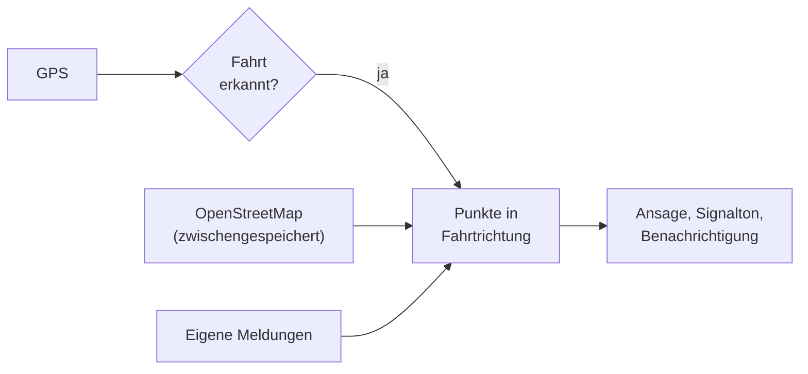
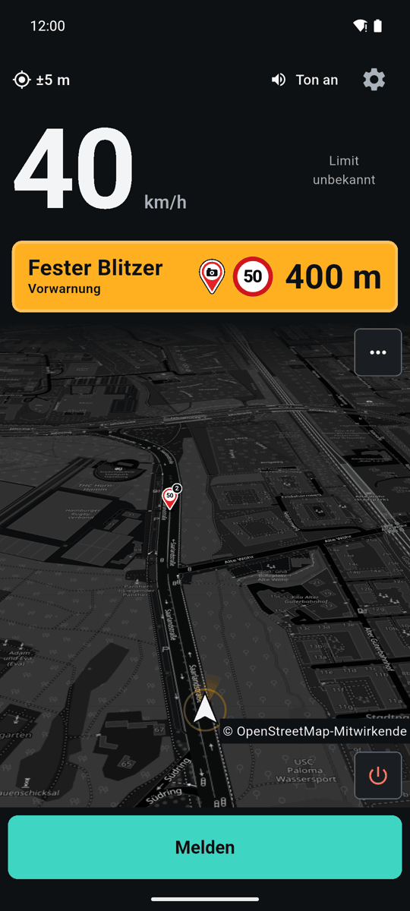
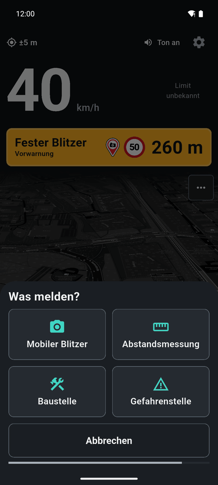
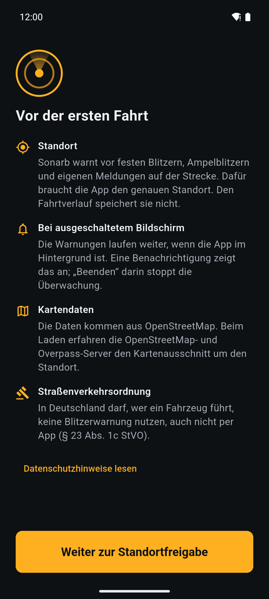

<p align="center"></p>

<h1 align="center">Sonarb</h1>

<p align="center"><b>Warnt beim Autofahren vor festen Blitzern aus OpenStreetMap und vor Stellen, die du selbst meldest.</b><br>Android-App, ohne Konto, ohne Werbung, ohne eigenen Server.</p>

<p align="center">
  <a href="LICENSE"></a>
  
  
</p>

<p align="center">
  <a href="#installation"><b>Installation</b></a> &nbsp;·&nbsp;
  <a href="#datenschutz-und-deine-daten">Datenschutz</a> &nbsp;·&nbsp;
  <a href="docs/README.md">Dokumentation</a> &nbsp;·&nbsp;
  <a href="CONTRIBUTING.md">Mitmachen</a>
</p>

Sonarb läuft während der Fahrt mit, zeigt Tempo und Tempolimit und sagt Messstellen auf deiner Strecke an,
bevor du sie erreichst. Die Daten stammen aus [OpenStreetMap](https://www.openstreetmap.org), also aus einer
offenen Karte, die Freiwillige pflegen. Fehlt ein Blitzer, kannst du ihn dort nachtragen; mobile Blitzer,
Baustellen und Gefahrenstellen meldest du mit zwei Tipps in der App. Alles, was Sonarb speichert, bleibt auf
deinem Handy.

> [!IMPORTANT]
> In Deutschland darf, wer ein Fahrzeug führt, keine Blitzerwarnung nutzen, auch nicht per App
> (§ 23 Abs. 1c StVO). Andere Länder haben eigene Regeln, manche verbieten solche Apps ganz. Du bist selbst
> dafür verantwortlich, wie und wo du Sonarb einsetzt. Das ist ein Hinweis, keine Rechtsberatung.

## So funktioniert es



Sonarb erkennt eine Fahrt, sobald du drei Messungen hintereinander schneller als 15 km/h bist. Dann prüft die
App jede Sekunde, welche Messstellen vor dir auf deiner Fahrtlinie liegen und in deine Richtung messen. Die
Daten dafür lädt sie in Kacheln von OpenStreetMap und hält sie auf dem Gerät vor. Im Stand ortet sie
sparsam, damit der Akku hält. Mehr dazu in [docs/ARCHITEKTUR.md](docs/ARCHITEKTUR.md).

## Funktionen

- **Warnungen in Stufen:** zuerst eine Ansage mit Signalton („Fester Blitzer voraus, Tempo 50“), beim
  Näherkommen zwei Piepe, kurz davor eine schnelle Folge. Gewarnt wird vor festen Blitzern, Rotlichtblitzern,
  Abschnittskontrollen, Abstandsmessungen und weiteren Kontrollen, soweit sie in OpenStreetMap eingetragen sind.
- **Piepen nur, wenn es nötig ist:** Die Piepe nach der Ansage kommen standardmäßig nur, wenn du schneller
  als das Limit plus 3 km/h fährst. Beides lässt sich einstellen („Piepen nur, wenn ich zu schnell bin“,
  „Zu schnell ab“).
- **Tempo und Tempolimit:** großes Tacho-Feld mit Schild daneben; die Zahl färbt sich, wenn du zu schnell bist.
  Das Limit kommt aus OpenStreetMap; fehlt es dort, steht „Limit unbekannt“.
- **Melden mit zwei Tipps:** „Melden“, dann Mobiler Blitzer, Abstandsmessung, Baustelle oder Gefahrenstelle.
  Fünf Sekunden lang lässt sich das rückgängig machen. Beim nächsten Vorbeifahren warnt Sonarb dort.
- **Läuft im Hintergrund weiter:** auch bei ausgeschaltetem Bildschirm oder mit einer Navigations-App im
  Vordergrund. Eine Benachrichtigung zeigt Tempo und nächste Messstelle; „Beenden“ hält Sonarb an.
- **Karte mit Fahrtrichtung oben**, bei Fahrt schräg nach vorn geneigt. Antippen eines Symbols zeigt Art,
  Tempolimit, Entfernung und Quelle.
- **Fahrstatistik:** Strecke, Fahrzeit, Tempoverteilung, Zeit über dem Limit, Bremsungen. Nur Zahlen je Fahrt,
  keine Orte. Abschaltbar.

<details>
<summary><b>Weitere Funktionen</b></summary>

- Jeder Satz der Sprachansage lässt sich einzeln abschalten und vorher anhören; „Stumm“ schaltet alle Töne ab.
- Andere Apps (Musik, Navigation) werden während einer Ansage leiser, nicht angehalten.
- „Blitzer für ganz Deutschland“ (aus): lädt einmal alle festen Messstellen des Landes, etwa 1 MB, und zeigt
  sie beim Herauszoomen.
- Umkreis für Daten einstellbar (5, 10, 25 oder 50 km); Kartenebenen und eine Legende der Symbole.
- Eigene Meldungen als Liste bearbeiten, als JSON-Datei exportieren und importieren
  ([Format](docs/HOTSPOT-FORMAT.md)).
- Der Bildschirm bleibt während der Fahrt an, solange Sonarb sichtbar ist, im Stand nicht.

</details>

## Einblick

<table>
  <tr>
    <td></td>
    <td></td>
    <td></td>
  </tr>
</table>

<i>Ansage vor einem festen Blitzer, Melden-Blatt und erster Start, aufgenommen im Emulator auf einer erfundenen
Testfahrt. Kartenbild © OpenStreetMap-Mitwirkende.</i>

## Installation

| Wo | Hinweis |
|---|---|
| Google Play | Der Eintrag im Play Store folgt. |
| Selbst bauen | siehe [Entwicklung](#entwicklung) |

Sonarb braucht Android 10 oder neuer, GPS und beim ersten Laden eine Internetverbindung. Die Oberfläche und
die Ansagen sind deutsch; für die Ansagen nutzt Sonarb die deutsche Stimme des Systems. Fehlt sie, gibt es nur
Signaltöne.

### Erster Start

1. Der Bildschirm „Vor der ersten Fahrt“ erklärt, wofür Sonarb den Standort braucht und was im Hintergrund
   läuft. Danach fragt Android nach dem Standort; „Bei Nutzung der App“ genügt.
2. Android 13 und neuer fragt zusätzlich nach Benachrichtigungen. Ohne sie läuft Sonarb weiter, nur ohne
   sichtbare Anzeige im Hintergrund.
3. Sonarb lädt die Messstellen der Umgebung. Danach losfahren: Die Überwachung startet von selbst, einen
   Start-Knopf gibt es nicht.

## Im Alltag

| Was | Wie |
|---|---|
| Stelle melden | „Melden“ unten im Cockpit, dann die Art wählen |
| Töne aus | „Ton an“ oben im Cockpit antippen, oder Einstellungen → „Stumm“ |
| Wann angesagt wird | Einstellungen → Warnung → „Ansage ab“ (Standard 600 m, bei hohem Tempo früher) |
| Sätze einzeln abschalten | Einstellungen → „Sprachansagen“ |
| Karte ausrichten | Menü „⋯“ auf der Karte: Norden oder Fahrtrichtung oben, flach oder geneigt |
| Sonarb ganz beenden | Aus-Knopf unten rechts auf der Karte, oder „Beenden“ in der Benachrichtigung |

## Datenschutz und deine Daten

- **Kein Konto, keine Werbung, keine Nutzungsstatistik, kein Sonarb-Server.**
- **Standort:** Sonarb liest ihn, solange die Überwachung läuft, und speichert keinen Fahrtverlauf.
- **Was ins Netz geht:** Zum Laden der Kartendaten fragt Sonarb die öffentlichen Overpass-Server
  (`overpass-api.de` von FOSSGIS e. V., ersatzweise `overpass.private.coffee`) und den Kachelserver
  `tile.openstreetmap.org` ab. Diese erfahren dabei die IP-Adresse und den Kartenausschnitt um deinen
  Standort. Die Ortung selbst läuft auf den meisten Geräten über die Google-Play-Dienste. Lädt man
  Tempolimit-Pakete, erhält GitHub (GitHub Inc., USA) die IP-Adresse und das gewählte Bundesland; diese
  Funktion folgt, sobald das Paket-Repository öffentlich ist.
- **Navigation von Google Maps (aus, bis du es einschaltest):** Mit deiner Freigabe liest Sonarb den Text
  der Navigationsmitteilung von Google Maps mit, nur im Arbeitsspeicher. Gespeichert oder gesendet wird
  nichts, andere Apps liest Sonarb nicht.
- **Was auf dem Gerät liegt:** Einstellungen, Zwischenspeicher der Kartendaten und Kartenbilder, deine
  Meldungen und die Fahrstatistik, alles im privaten Speicher der App.
- **Alles löschen:** App deinstallieren oder in den Android-Einstellungen der App „Speicher löschen“.
  Einzeln: Einstellungen → „OSM-Cache“ → „Leeren“, Fahrstatistik → „Alle Fahrten löschen“.

Die vollständigen Datenschutzhinweise stehen in der App unter Einstellungen → Über → „Datenschutz“.

## Probleme und Lösungen

| Problem | Was hilft |
|---|---|
| Keine Warnung, obwohl ein Blitzer kommt | Gewarnt wird erst ab erkannter Fahrt (über 15 km/h) und nur vor Messstellen in deiner Fahrtrichtung. Fehlt der Blitzer in OpenStreetMap oder ist seine Richtung falsch eingetragen, kannst du das auf [openstreetmap.org](https://www.openstreetmap.org/fixthemap) korrigieren. |
| „Blitzer nicht geladen“ | Keine Verbindung oder die öffentlichen Overpass-Server sind überlastet. Sonarb versucht es von selbst wieder; bereits geladene Gegenden bleiben verfügbar. |
| „Limit unbekannt“ | Für diese Straße ist in OpenStreetMap kein Tempolimit eingetragen. Sonarb schätzt keins. |
| Keine Sprachansage, nur Piepe | Es fehlt eine deutsche Stimme. In den Android-Einstellungen unter Sprachausgabe eine deutsche Stimme laden. |
| Warnungen hören im Hintergrund auf | Energiesparfunktionen mancher Hersteller beenden Hintergrund-Apps. Sonarb in den Akku-Einstellungen von der Optimierung ausnehmen. |
| Standort wird nur langsam gefunden | Steht unter Einstellungen → Ortung „Ortung ohne Google-Standortgenauigkeit“, dort „Erneut anfragen“ und die Google-Standortgenauigkeit erlauben. |

Etwas anderes? [Fehler melden](https://github.com/FynnXland/sonarb/issues/new/choose).

## Entwicklung

```bash
git clone https://github.com/FynnXland/sonarb.git
cd sonarb
flutter pub get
flutter run                     # auf Gerät oder Emulator
flutter analyze
flutter test                    # gut tausend Tests, ohne Netz und ohne Gerät
flutter build apk --debug       # ohne Keystore
```

Gebraucht wird Flutter 3.47 (stable). Eigene Datenquellen lassen sich als lokale Plugins einbinden, die nie
im Repository landen ([docs/PLUGINS.md](docs/PLUGINS.md)). Alles Weitere zu Aufbau, Tests und Regeln steht in
[CONTRIBUTING.md](CONTRIBUTING.md) und [docs/](docs/README.md).

## Danke

Sonarb baut auf [OpenStreetMap](https://www.openstreetmap.org/copyright) und seinen Mitwirkenden auf, auf den
Overpass-Servern von [FOSSGIS](https://www.fossgis.de) und [private.coffee](https://private.coffee), auf
[Flutter](https://flutter.dev) und [flutter_map](https://github.com/fleaflet/flutter_map). Alle Pakete und
ihre Lizenzen stehen in [THIRD-PARTY-NOTICES.md](THIRD-PARTY-NOTICES.md).

## Lizenz

Der Code steht unter der [MIT-Lizenz](LICENSE). Ausgenommen sind Daten, die aus OpenStreetMap stammen: die
Testdaten unter `test/osm/` (JSON-Dateien und `parity/golden.sblp`), die Teststrecke `tool/media/route.json`
und das Länderraster `lib/features/osm/land_grid.dart`. Sie stehen, wie alle Kartendaten der App, unter der
[Open Database License](https://opendatacommons.org/licenses/odbl/1-0/), © OpenStreetMap-Mitwirkende.

Unless you explicitly state otherwise, any contribution you submit for inclusion in this project is licensed
under the MIT License, without additional terms or conditions.

Copyright (c) 2026 FynnXland
